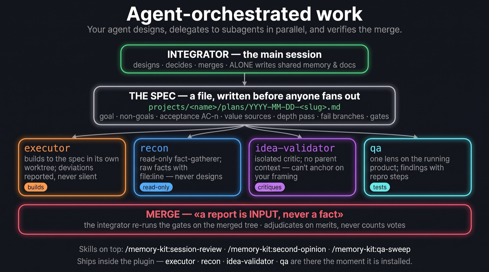

# Claude Memory Kit

**An agent that remembers where you stopped — and a working method for checking its "done".**

Claude Memory Kit is a plugin for Claude Code. Install it in a repository and you get three things:

- **Every session opens where the last one ended.** The agent keeps short dated notes and a handoff as plain files in
  your repository and reads them at the next start. You stop re-explaining the project.
- **Dangerous commands are stopped before they run.** A force push, `reset --hard`, a read of `.env`, an edit that
  weakens a test — blocked or asked about first.
- **A method for handing work to helper agents, so that "done" means checked.** The helper builds from a written spec;
  the main agent verifies the helper's report before it tells you "done"; a fix made after a review is itself reviewed
  by an agent that did not write it; a mistake that shows up three times is turned into a check. It is a method, not an
  automatic gate: `setup` offers one short always-loaded rule file, and the rest is reference the agent opens when the
  work calls for it.

Nothing becomes a rule without your yes. No database, no service, no API key — text files you can read and diff.
An independent project, not made or endorsed by Anthropic.

**Why the method matters.** In one project, in five of six pieces of work the fix made after a review reached acceptance
with nobody reviewing the fix itself; checked afterwards, two of those five carried a defect serious enough to block. A
small sample from one project — a reason to look at your own fixes, not a proven rate.

[](https://github.com/awrshift/agent-memory-kit/releases)
[](LICENSE)
[](#install)

**On this page:** [How it works](#how-it-works) · [Install](#install) · [The method](#the-method-in-one-screen) ·
[What is inside](#what-is-inside) · [Reference](#reference--read-on-demand) ·
[What it writes](#what-it-writes-in-your-repository) · [Privacy and cost](#privacy-and-cost) ·
[Proof status](#proof-status)

## How it works

1. **You work as usual.** When something is worth keeping, the agent writes one dated line and tells you.
2. **You close the session.** It looks for patterns across days («you rejected this on four different days — make it
   a rule?»), writes what you approve, and leaves a handoff note.
3. **The next session starts already knowing** — memory, the handoff and the list of knowledge articles are loaded
   by a hook.
4. **When you delegate,** the work goes through a spec file, a review of every diff and a record of what was accepted
   and why. This half is optional: take it when you hand work to helper agents or run several sessions at once.

## Install

Inside the repository, in Claude Code:

```shell
/plugin marketplace add awrshift/agent-memory-kit
/plugin install memory-kit@memory-kit
/memory-kit:setup
```

`setup` reads what the repository already has and **proposes before writing anything**; your `CLAUDE.md` stays yours.
Git is optional. To upgrade later: `claude plugin marketplace update memory-kit`, then
`claude plugin update memory-kit@memory-kit` (the full id is needed), and restart the session. Upgrades never touch
your files. In a repository that never ran `setup`, the hooks inject one pointer line and write nothing.

## The method in one screen



This is a method the agent follows, not something the hooks enforce. The main session designs, decides and integrates;
helpers build or gather facts from a spec file. The always-loaded invariants live in `templates/rules/orchestration.md`
(a plugin cannot ship rules; `setup` offers to copy it).

| Step | What happens | Open |
|---|---|---|
| 1. Spec file | Goal, non-goals, acceptance `AC-n` written first, value sources, gates; a depth pass, a practice line and a review line before hand-over; a reader who did not write it checks it against the code | `SPEC-TEMPLATE.md` · `reference/spec-depth.md` |
| 2. Build | `executor` (or your own builder) in a worktree, one integrator; several sessions → one main and windows working from brief files | `reference/parallel-development.md` · `reference/window-cycle.md` · `WINDOW-BRIEF-TEMPLATE.md` |
| 3. Review, fix rounds included | Every nontrivial diff, and every fix round's diff, reviewed by an agent that did not write it; findings triaged to the owning layer; a fix round may not redesign | `reference/review-loop.md` §0–§1 · `reference/review-classes.md` · `reference/acceptance.md` |
| 4. Acceptance record | One file per accepted head: spec, rounds, review, gates re-run on that tree, one ruling per finding | `reference/acceptance.md` · `ACCEPTANCE-TEMPLATE.md` · `reference/orchestrator-fact-check.md` |
| 5. Findings registry | Each confirmed finding logged by class and family; a family seen three times is promoted into a check | `reference/review-loop.md` §2 |

## What is inside

The rest of this page is the full inventory, for when you need to know exactly what runs: what fires by itself, what
you call, what you copy, what it writes and what it costs.

### What fires by itself (hooks)

Wired in `hooks/hooks.json`. What each injects or blocks, and how to turn it off:

| Event (matcher) | Script | Injects or blocks | Off-switch / knob |
|---|---|---|---|
| SessionStart (startup · clear · resume · compact · fork) | `session-start.py`, run as `--part 1..6` (each part under Claude Code's 10,000-character cap on one hook's context) | Injects the working agreement `context/identity.md`, the nudges that fire (memory over its caps, session-headed blocks, a path in memory that no longer exists, specs `assumed` or `building` too long, a «Rails:» line for missing permission rails, a project hook that is a copy of a kit hook), session stats, `MEMORY.md`, the newest handoff and `knowledge/index.md`. `compact` gets back what compaction dropped; `resume` gets only nudges and stats | `CMK_INJECT_BUDGET` (48000) · `CMK_MEMORY_LINE_CAP` (180) · `CMK_MEMORY_BYTE_CAP` (32768) · `CMK_MEMORY_MAXLINE_CAP` (3000) · `CMK_SPEC_STALE_DAYS` (14) |
| PreCompact | `pre-compact.sh` | A manual `/compact` is blocked until `MEMORY.md` was written in the last 2 minutes and sits inside its caps. An automatic compaction is never blocked; when it ran over unsaved memory, the next context opens with «save memory now» | none (no-op in an unadopted repository) |
| PreToolUse (Edit · Write) | `protect-tests.py` | Asks before an edit that can weaken an existing test (an assertion changed or removed, `.skip` / `.only` added) and before any hand edit of a `.snap`. Files created in this session pass | `CMK_ALLOW_TEST_EDITS=1` |
| PreToolUse (Bash) | `guard-git.py` | Blocks force push, `push --mirror`, `reset --hard`, `clean -f`, `branch -D`, `checkout .`, `restore .` in a real git command; `--force-with-lease` passes | `CMK_GIT_GUARD=off` |
| PreToolUse (Bash) | `guard-zsh-split.py` | zsh only: blocks a command that relies on bash word-splitting of an unquoted variable, or an unbraced `$NAME:` that zsh reads as a history modifier | `# zsh-split-ok` in the command · `CMK_ZSH_GUARD=off` |
| PreToolUse (Read · Edit · Write · Bash) | `guard-secrets.py` | Blocks reading or writing `.env` files, keys and certificates by a file tool, a shell command or a redirection; one literal `echo` / `printf` appending a line to `.env` passes | `CMK_SECRETS_GUARD=off` |
| SessionEnd | `session-end.sh` | Appends one timestamp line to `.claude/state/session-end.log` | none |

The git and secrets guards carry `"onFailure": "block"`: a guard that crashes or times out blocks the call (Claude
Code 2.1.295 or later). Shared code in `hooks/lib/`: `cmdparse.py` (one shell-command parser for every guard),
`rails.py` (permission-settings facts), `stale-refs.py` (paths in memory that no longer exist), `legacy_hooks.py` (a
project's own copy of a kit hook), `statefs.py` and `state.sh` (state writes: never through a symlink, never outside
the project). Profiles and limits in detail: [`plugins/memory-kit/README.md`](plugins/memory-kit/README.md).

### What you invoke (skills)

All are `/memory-kit:<name>` and also trigger from plain words; until a skill runs only its description is in context.

| Skill | What it does |
|---|---|
| `setup` | Adopts the kit here, settles coexistence with Claude Code's auto memory, offers permission rails, the orchestration rule and the role templates — each on a yes. `setup rails` re-runs only the rails; `setup adopt` sorts the kit's practices for this repository |
| `close-session` | End of session: capture, look for a pattern on 3+ dates, promote on a yes, write the handoff. Says how a project adapts it, begins below the compaction point, merges memory lines at write time |
| `memory-audit` | When memory trips a cap: a move plan for your approval, then the moves |
| `system-audit` | Periodic health check of the whole setup through its lenses; measures which layers fired, proves each guard through its exact wiring |
| `session-review` | Adversarial review of a session's work by an isolated reviewer that reads the files; a retro's facts come from the session logs by script, at most three changes |
| `second-opinion` | Independent reviewers on one high-stakes decision before it reaches you |
| `qa-sweep` | Multi-lens QA of the running product by `qa` agents, every finding with repro steps |
| `document` | PR body, changelog entry, release note or postmortem, written only from `git diff` / `git log`; runs the claim-refs check on the draft |
| `code-sync` | After a merge: spec statuses reconciled with what the code shows |
| `tour` | A walkthrough of the kit on your own files |

### Agents and role templates

**Live agents** — listed in every session once the plugin is installed (`agents/`):

| Agent | Model | Role |
|---|---|---|
| `executor` | Opus | Builds to a decided spec in its own worktree; never redesigns, reports any deviation, stops on a value with no source |
| `recon` | Sonnet | Read-only facts with file and line; official sources for anything outside the repo |
| `idea-validator` | Opus | Isolated critic with none of your conversation |
| `qa` | Sonnet | One QA lens on the running product; observes, never fixes |

**Role templates** — `templates/agents/`, copied into your `.claude/agents/` only on a yes (`setup` offers them), then
filled. Each starts with `omitClaudeMd: true`, so the file carries what the helper must know. In trial in one project;
the roster and the rule «judges → the stronger model, collects or counts → the cheaper»: `reference/helper-roster.md`.

| Template | Model | Use when |
|---|---|---|
| `code-reviewer.md` | Opus | A built diff, or a fix round's diff, is reviewed against its spec by someone who did not write it |
| `prebuild-reader.md` | Opus | A spec is read against the code at its base commit before the build |
| `tool-builder.md` | Opus | A measurement, gate or harness script is built to a decided brief |
| `web-recon.md` | Sonnet | A decision rests on an outside fact that may have moved (vendor, library, limit) |
| `labeler.md` | Opus | Rows are labelled by a written rubric, blind to the hypothesis |

### Reference — read on demand

`reference/` costs nothing until opened. Proof tags inside each file say what a line rests on.

| File | Open it when |
|---|---|
| `reference/adoption.md` | After an install or upgrade: what to take as is, what to adapt, what to skip |
| `reference/spec-depth.md` | Writing a spec: depth pass, fresh-checked practice, review by stake, the pre-build read, paid runs with a cap |
| `reference/orchestrator-fact-check.md` | Accepting anyone's report, or telling the user how things are now: the claim → check table |
| `reference/review-loop.md` | Handling findings: triage and the fix spec's family line, the diff gate, the findings registry |
| `reference/acceptance.md` | You accept a helper's build after a review round (in trial) |
| `reference/review-classes.md` | Reviewing a diff or writing a checklist: defect classes one backend project met, each with its check (one project's practice) |
| `reference/parallel-development.md` | Fanning work out: worktrees, one integrator, held work that drifts, flow limits |
| `reference/window-cycle.md` | You run more than one interactive session on one repository (one project's practice) |
| `reference/helper-roster.md` | You delegate to helpers often: a role and an explicit model per call (in trial) |
| `reference/measurement-lessons.md` | Before a bar on a count or a model's judgment deciding a change (counts from one project) |
| `reference/reporting.md` | Writing a status, a close report or an answer to the user's comment (one project's practice) |
| `reference/rules-subtraction.md` | Your always-loaded instructions grew one line per incident and need cutting |
| `reference/doc-governance.md` | Keeping docs true: one home per fact, derived state not kept by hand, archive moves |
| `reference/decisions-log.md` | Recording a product or architecture decision in a lean ledger |
| `reference/project-extensions.md` | Adding your own rule, skill, hook or agent; what each costs idle; ideas measured and not built |
| `reference/harness-measurement.md` | Changing settings, hooks or rules: probes before and after; dated harness notes |
| `reference/capability-map-sweep.md` | Code duplicates what an installed library already does |
| `reference/qa-PROTOCOL-TEMPLATE.md` · `reference/qa-mcp.json.example` | Setting up `qa-sweep` for a product |

### Templates and scripts

Copied on request by `setup` or a skill; none loads by itself.

| Kind | Files |
|---|---|
| Memory | `templates/MEMORY-TEMPLATE.md` · `templates/HANDOFF-TEMPLATE.md` · `templates/workspace/knowledge-index.md` |
| Rules | `templates/rules/orchestration.md` (the invariants for work with helpers) · `templates/rule-template.md` (one checkable always/never, scoped by `paths:`) |
| Per project | `templates/workspace/project/README-TEMPLATE.md` (map and workflow tier) · `BACKLOG-TEMPLATE.md` · `SPEC-TEMPLATE.md` (the contract) · `ASSUMED-SPEC-TEMPLATE.md` (an executor's override owed your ratification) · `ACCEPTANCE-TEMPLATE.md` (in trial) |
| Parallel work | `templates/workspace/WINDOW-BRIEF-TEMPLATE.md` (in trial) |
| Sandbox, onboarding | `templates/workspace/EXPERIMENT-TEMPLATE.md` · `experiments-README.md` · `ONBOARDING-BACKLOG.md` |
| `document` | `pr.md` · `changelog.md` · `release-note.md` · `postmortem.md` |
| Scripts | `scripts/quiet.sh` (a noisy command: full log to a file, a summary, proof that a `git commit` landed) · `scripts/permission-probes.sh` (do your permission rules stop what they should) · `scripts/claim-refs-check.py` (every path and commit an outgoing text names exists; run before a PR body or release note leaves — one project's practice) · `system-audit` carries `collect.sh`, `gates.py`, `usage.py` |

The working agreement, `context/identity.md`, is the kit's only always-on instruction text, injected at every start.

```
plugins/memory-kit/
├── hooks/       hooks.json · the scripts above · lib/ · tests/
├── skills/      one folder per skill
├── agents/      the live agents
├── reference/   the files above
├── templates/   memory · rules · agents · workspace · project
├── scripts/     the scripts above · tests/
└── context/     identity.md
```

## What it writes in your repository

Only state, and only after `setup`:

```
your-repo/
├── .claude/memory/MEMORY.md   hot cache: dated one-liners, capped at 180 lines / 32 KB / 3000 chars a line
├── .claude/state/             session counter, logs (kit-owned)
├── context/handoffs/          one note per session; the newest is injected at the next start
├── knowledge/                 index.md + concepts/: one article per settled topic, written after your yes
├── .claude/rules/             always / never: what you promoted, plus any template you copied
└── projects/<name>/           README (the map) · BACKLOG · plans/ · research/ · decisions-log.md ·
                               review-findings.md · qa/ — past the first two, created on first use
```

A pattern's path: a dated line → (seen on 3+ dates, with your yes) a knowledge article → (stable, mechanical) a rule.
`setup` writes `.claude/settings.json` only after you approve its diff (`autoMemoryEnabled: false` if the kit owns
memory; `Read` / `Edit` deny rules for root `.env` files). `document` writes where a human looks: `CHANGELOG.md`,
`docs/releases/`, `docs/postmortems/`. Role templates and rule templates land in `.claude/agents/` and
`.claude/rules/` only when you say yes.

**Versus Claude Code's own auto memory:** that one is on by default, written by the agent, and lives in
`~/.claude/projects/` on one machine. The kit's memory is text in the repository — diffable, dated, shared with a
teammate if you commit it, promoted only on your yes. Running both means two writers, so `setup` asks you to pick one.

## Privacy and cost

- **The kit itself sends nothing.** No hook or script opens a network connection; all are readable Python or shell.
  Claude Code sends what it reads, memory included, to the model, as with any file in the conversation.
- **Private by default.** The hot cache and handoffs are gitignored, so they stay local even if you push. The
  knowledge base and rules are tracked: keep the repository private or prune before publishing. Working from two
  machines or with a teammate? Say so at `setup` and the hot cache gets committed instead.
- **Forgot to close the session?** Nothing breaks: the next session still opens with your memory. You lose that
  session's handoff note and the pattern audit.
- **Cost at session start:** about 6.5–8.5k tokens on three working repositories (measured 2026-09-26), bounded by
  the memory caps, plus the skill and agent descriptions, which load at every start. Skill bodies, agent bodies,
  `reference/` and templates cost nothing until used; each role template you copy adds its description to every start.

## Proof status

Built and used daily by its maintainer since March 2026; layers that rotted were retired (`docs/ARCHITECTURE.md`,
«What's NOT in the architecture»). Most of the method added in 8.2.0 is **one project's practice**, not a standard:
each practice in those files carries its tag — `(measured in one project, 2026-11: <count>)`, `(in trial in one
project since <date>; count due <date>)` or `(one project's working practice; no count)` — and each new file or
section opens with an «Applies when:» condition you can test on your repository. Take what your condition matches;
what changed in each release and for whom: [`docs/CHANGELOG.md`](docs/CHANGELOG.md).
After an install or an upgrade, `/memory-kit:setup adopt` sorts these practices for your repository — take, adapt
or skip, each with its reason (`reference/adoption.md`).

[Architecture](docs/ARCHITECTURE.md) · [Claude Code facts](docs/specs/claude-code.md) · [Changelog](docs/CHANGELOG.md) ·
[Contributing](docs/CONTRIBUTING.md) · [Open decisions](docs/DECISIONS.md) · [Assets](docs/ASSETS.md) ·
[Issues](https://github.com/awrshift/agent-memory-kit/issues) · MIT, see [LICENSE](LICENSE).
