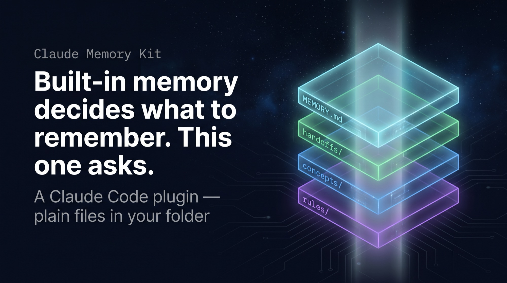
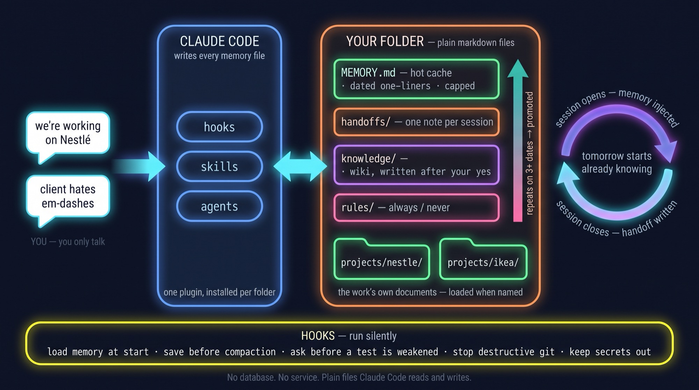
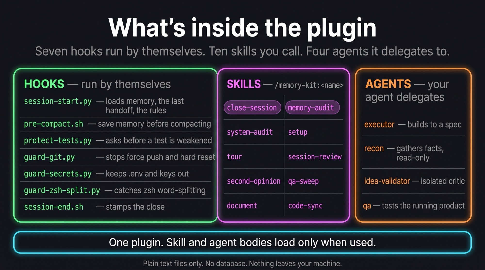
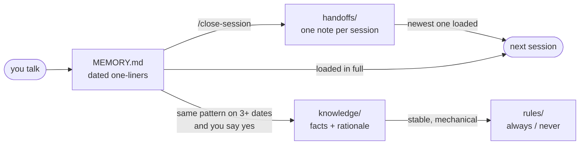
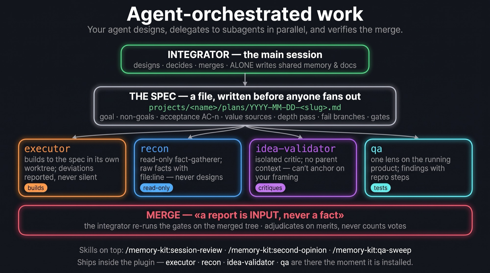

# Claude Memory Kit

**Built-in memory decides what to remember. This one asks.**

Claude Memory Kit is a Claude Code plugin that gives your coding agent a memory made of plain text files in your own
folder. Session two opens with *"you were on Nestlé, the client hates em-dashes, next step: the Q3 brief"* — without
you explaining anything again. The agent notes small facts as dated lines and tells you; nothing becomes a rule or a
knowledge article until you say yes. No database, no service, no API key.
An independent project, not made or endorsed by Anthropic.

**Optional second half, for people who delegate to subagents:** a method that ships with it — specs written as files
before work starts, a subagent's report treated as a claim until checked, review findings that turn into checks.

[](https://github.com/awrshift/agent-memory-kit/releases)
[](LICENSE)
[](#install)

**On this page:** [How it works](#how-it-works) · [Install](#install) · [What is inside the plugin](#what-is-inside-the-plugin) ·
[What it creates in your folder](#what-it-creates-in-your-folder) · [The method](#the-method-for-work-with-subagents) ·
[Why not built-in memory](#why-not-the-built-in-memory) · [Privacy and cost](#privacy-and-cost)

## How it works



1. **You talk.** "We're working on Nestlé." "The client hates em-dashes." You never open a memory file.
2. **The agent writes.** Something worth keeping becomes one dated line in `MEMORY.md`, and the agent tells you
   ("saved", with the line).
   The work itself (backlog, specs, research, decisions) goes into that client's own folder, `projects/<client>/`.
3. **You close the day.** Say "we're done for today". The agent looks for patterns across dates ("you rejected
   em-dashes on four different days, make it a rule?"), writes what you approve, and leaves a handoff note.
4. **Tomorrow starts already knowing.** At the next session start a hook loads the memory, the newest handoff and the
   knowledge index. Nothing becomes a rule without your yes, and every line carries its date, so a stale fact looks stale.

## Install

Inside the folder you work in, in Claude Code:

```shell
/plugin marketplace add awrshift/agent-memory-kit
/plugin install memory-kit@memory-kit
/memory-kit:setup
```

`setup` reads what the folder already has and **proposes before writing anything**; your `CLAUDE.md` stays yours.
Git is optional. To upgrade later: `claude plugin marketplace update memory-kit`, then
`claude plugin update memory-kit@memory-kit` (the full id is needed), and restart the session. Upgrades never touch
your files.

## What is inside the plugin

A plugin install hides its file tree, so here is all of it.



### Hooks — run by themselves

| Hook | When | What it does |
|---|---|---|
| `session-start.py` | every session start, and after a compaction | Loads the working agreement, your `MEMORY.md`, the newest handoff and the knowledge index. Warns when memory is over its caps, when a path in memory no longer exists, when a spec is waiting for your ratification, and when your project wires its own copy of a kit hook (it would run twice). |
| `pre-compact.sh` | before the conversation is compacted | A manual `/compact` waits until memory is saved and inside its caps. An automatic compaction is never blocked (that would fail your request); if it ran over unsaved memory, the next context opens with "save memory now". |
| `protect-tests.py` | before a file edit | Asks before an edit that could weaken an existing test: an assertion changed or removed, a `.skip` or `.only` added. New tests pass silently. |
| `guard-git.py` | before a shell command | Stops force push, `push --mirror`, `reset --hard`, `clean -f`, `branch -D`, `checkout .`. `--force-with-lease` passes. |
| `guard-secrets.py` | before a read, edit or shell command | Keeps `.env` files, keys and certificates out of the transcript, whether by a file tool, a shell command or a redirection. One exception: a single literal `echo` or `printf` appending a line to `.env`. |
| `guard-zsh-split.py` | before a shell command, in zsh only | Catches a variable that zsh will NOT split into words the way bash does, before the command silently does the wrong thing. |
| `session-end.sh` | when the session ends | Writes one timestamp line, nothing else. |

The guards for git and secrets block the action if they crash or time out, instead of letting it through (Claude Code
2.1.295 or later; older versions accept the setting but let the action through). Each guard
names its opt-out variable. In a folder that never ran `setup`, the hooks write nothing.
Shared code in `hooks/lib/`: `cmdparse.py` (one shell-command parser for every guard), `rails.py` (permission settings
facts), `stale-refs.py` (finds paths in memory that no longer exist), `legacy_hooks.py` (spots a project's own copy of a
kit hook), `statefs.py` and `state.sh` (write the kit's state files safely: never through a symlink, never outside the
project).

### Skills — you call them, or just say what you want

All are named `/memory-kit:<name>`, and each one also triggers from plain words. Until a skill runs, only its one-line
description sits in the context.

| Skill | What it does |
|---|---|
| `close-session` | The end-of-day ritual: capture what is new, look for patterns on 3+ dates, promote on your yes, refresh the memory header, write the handoff. |
| `memory-audit` | When memory trips a cap: a table of moves (to the knowledge base, to a rule, or out) for your approval, then the moves. |
| `system-audit` | The periodic health check of the whole setup through seven lenses; it measures which layers actually fired and proves each guard through its real wiring. |
| `setup` | Adopts the kit in this folder, settles how it coexists with Claude Code's own auto memory, and offers safe permission rails. |
| `tour` | A walkthrough of the kit on your own files. |
| `session-review` | An adversarial review of a session's work by an isolated reviewer that reads the actual files. |
| `second-opinion` | Independent reviewers on one high-stakes decision before it reaches you. If you already run your own review board, use that instead. |
| `qa-sweep` | A multi-lens QA pass over your running product, every finding with repro steps. |
| `document` | A PR description, changelog entry, release note or postmortem, written only from the actual `git diff`. |
| `code-sync` | After a merge, reconciles each spec's status with what the code now shows. |

### Agents — workers your agent delegates to

| Agent | Model | What it does |
|---|---|---|
| `executor` | Opus | Builds to a decided spec in its own git worktree. Never redesigns; any deviation is reported. Stops if a value it must produce has no source in the spec. |
| `recon` | Sonnet | Read-only fact gatherer: raw facts with file and line, official sources for anything outside the repo. Never designs. |
| `idea-validator` | Opus | An isolated critic with none of your conversation, so it cannot anchor on your framing. |
| `qa` | Sonnet | One QA lens on the running product (user flow, edge states, honesty, contract, UX). Observes, never fixes. |

### Rule templates — the always-loaded part you opt into

A plugin cannot install rules, so `setup` offers these and copies them only on your yes.

| Template | What it holds |
|---|---|
| `templates/rules/orchestration.md` | Nine invariants for working with subagents ([listed below](#the-method-for-work-with-subagents)). |
| `templates/rule-template.md` | The shape of a good rule: one checkable always/never, scoped by `paths:` so it loads only where it applies. |

### Reference — depth, read only when needed

| Doc | Read it when |
|---|---|
| `reference/spec-depth.md` | Writing a spec: the depth pass, checking outside facts fresh, review by stake, failure branches written first, measuring the outcome rather than a proxy. |
| `reference/orchestrator-fact-check.md` | Accepting anyone's report: how a claim becomes a fact, and the cheapest decisive check per kind of claim. |
| `reference/review-loop.md` | Handling findings: triage to the layer that owns them, the review gate on diffs, the registry that turns a repeated mistake into a check. |
| `reference/parallel-development.md` | Fanning work out: worktrees, one integrator, when to go sequential. |
| `reference/doc-governance.md` | Keeping docs true: one home per fact, dated status, nothing cited from a temp folder. |
| `reference/decisions-log.md` | Recording a product or architecture decision in a lean ledger. |
| `reference/project-extensions.md` | Adding your own rule, skill, hook or agent, and what each costs while idle. |
| `reference/harness-measurement.md` | Changing settings or hooks: prove it with a fixed probe set before and after. |
| `reference/capability-map-sweep.md` | Code duplicates what an installed library already does. |
| `reference/qa-PROTOCOL-TEMPLATE.md`, `reference/qa-mcp.json.example` | Setting up `qa-sweep` for a product. |

### Templates, scripts and the agreement

- **Memory files:** `templates/MEMORY-TEMPLATE.md`, `templates/HANDOFF-TEMPLATE.md`, `templates/workspace/knowledge-index.md`.
- **Per project:** `templates/workspace/project/README-TEMPLATE.md` (the project's map and workflow tier),
  `BACKLOG-TEMPLATE.md`, `SPEC-TEMPLATE.md` (the contract an executor builds to), `ASSUMED-SPEC-TEMPLATE.md` (an
  executor's recorded override, owed your ratification).
- **Other:** `EXPERIMENT-TEMPLATE.md` and `experiments-README.md` (a sandbox for throwaway work), `ONBOARDING-BACKLOG.md` (a first
  day in five tasks), and the four `document` templates (`pr.md`, `changelog.md`, `release-note.md`, `postmortem.md`).
- **Scripts:** `scripts/quiet.sh` (runs a noisy command, keeps the full log in a file, prints a summary),
  `scripts/permission-probes.sh` (checks that your permission rules stop what they should); `system-audit` carries
  `collect.sh`, `gates.py` and `usage.py`.
- **The working agreement:** `context/identity.md`, injected at every session start. It is the kit's only always-on
  instruction text, about 1.6k tokens.

```
plugins/memory-kit/
├── hooks/        hooks.json · session-start.py · pre-compact.sh · protect-tests.py · guard-git.py
│                 guard-secrets.py · guard-zsh-split.py · session-end.sh · lib/ · tests/
├── skills/       close-session · memory-audit · system-audit · setup · tour · session-review
│                 second-opinion · qa-sweep · document · code-sync
├── agents/       executor · recon · idea-validator · qa
├── reference/    the depth docs above
├── templates/    memory · rules · workspace · project
├── scripts/      quiet.sh · permission-probes.sh
└── context/      identity.md
```

## What it creates in your folder

Only state, and only after `setup`:

```
your-folder/
├── .claude/memory/MEMORY.md     hot cache: dated one-liners, capped at 180 lines / 32 KB / 3000 chars a line
├── context/handoffs/            one note per session; the newest is loaded at the next start
├── knowledge/                   the wiki: one article per settled topic, written after your yes
├── .claude/rules/               always / never, only what you promoted
└── projects/<client>/           each client's own documents: README (the map), BACKLOG, plans/, research/
```



A pattern's path: a dated line, then (seen on 3+ dates, with your yes) a knowledge article, then (stable and
mechanical) a rule. **Memory vs paperwork:** what the agent
learned is shared across your work; what the work produced belongs to one client's folder. Say "now IKEA" and the
agent reads that folder only.

## The method for work with subagents



The main session designs and decides; subagents build or gather facts from a spec written as a file before anyone
starts. The nine invariants in `templates/rules/orchestration.md`, in plain words:

1. A report from a subagent or reviewer is input, not a fact. Re-run the check, read the line, look at one real
   output yourself.
2. Subagents build to a decided spec file and never redesign; a deviation is reported, not absorbed.
3. A value with no named source stops the build as an owed decision; nothing is invented.
4. The main session alone writes memory and project documents, merges, and re-runs every check on the merged result.
5. A failing test means the code is wrong, not the test.
6. Reviewers are judged on merits, never by counting votes.
7. A subagent is resumed only for a short follow-up; new work gets a fresh one with a brief that points at files.
8. Every number in a report comes from a script or command shown next to it.
9. Scope, anything others will see, irreversible data changes and spending are yours to decide; technical choices are
   the agent's, explained as "decision, why it is correct, what would prove it wrong".

A spec also carries three lines before it is handed over (`reference/spec-depth.md`): a **depth pass** (what a top
expert in the field would do that nobody asked for), a **practice** line (outside facts checked against official
sources today, with the date), and a **review** line (who reviews it, by stake). Failure branches are written before
the run, and success is judged by what reaches the user, not by a counter.

## Why not the built-in memory?

Claude Code ships its own auto memory, on by default. It is effortless, and it lives outside your folder.

| | Claude Code auto memory | Claude Memory Kit |
|---|---|---|
| Who decides what is remembered | the agent, silently | the agent proposes, **you approve** |
| Where it lives | `~/.claude/projects/`, on this machine only | **plain files in your folder** |
| Can you read it, diff it, fix a wrong belief | partly | **yes, it is text** |
| One memory per client | no | **yes**, `projects/<client>/` |
| Shared with a teammate or a second machine | no | **yes**, it is in the repo |
| How staleness shows | it doesn't | **every line is dated**; caps force a prune |
| Cost at session start | up to 200 lines / 25 KB (Claude Code docs) | about 6.5–8.5k tokens on three working repositories (measured 2026-09-26), bounded by the caps, plus ~2k of skill and agent descriptions |

Running both means two writers and two truths, so `setup` asks you to pick one.

## Privacy and cost

- **The kit itself sends nothing.** No hook or script opens a network connection; all are readable Python or shell.
  Claude Code sends what it reads, memory included, to the model, as with any file in the conversation.
- **Private by default.** The hot cache and handoffs are gitignored, so they stay local even if you push. The
  knowledge base and rules are tracked: keep the repository private or prune before publishing. Working from two
  machines or with a teammate? Say so at `setup` and the hot cache gets committed instead.
- **Forgot to close the session?** Nothing breaks: the next session still opens with your memory. You lose that
  session's handoff note and the pattern audit.

## Origin

Built and used daily by one operator since March 2026, across marketing, research and product work, and the method
behind several production agent setups. Layers that quietly rotted were retired (a daily journal, a rolling status
file, a staging layer), and CI now checks on every push that the memory actually reaches the model and that this page
lists every part of the plugin.

A 68-second recording of a real session: [demo video](.github/assets/demo-full-session.mp4).
**Tell me how your first week went:** [open a note](https://github.com/awrshift/agent-memory-kit/issues/new?template=first-week.md).

[Architecture](docs/ARCHITECTURE.md) · [Claude Code facts](docs/specs/claude-code.md) · [Changelog](docs/CHANGELOG.md) ·
[Contributing](docs/CONTRIBUTING.md) · [Open decisions](docs/DECISIONS.md) · MIT, see [LICENSE](LICENSE).
