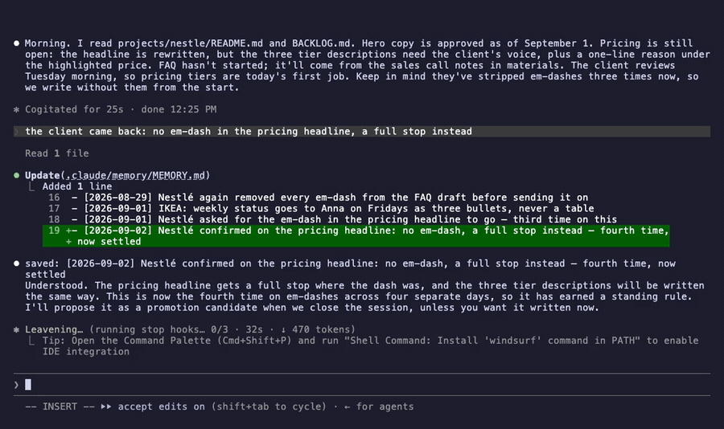
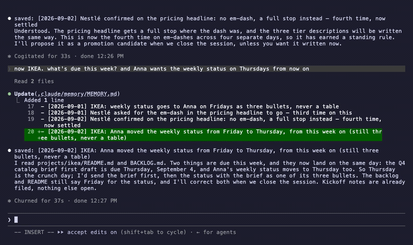
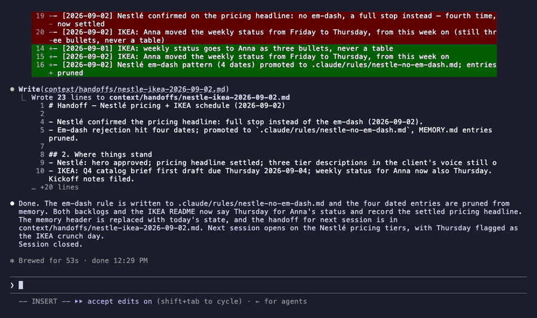

# README assets — state and how they are made

Nine diagrams and five demo clips in `.github/assets/` carry the visual story. Their text ages with
the product. The rule: **a diagram that states a fact is a fact that has to be swept like any
other** — same discipline as the docs, and a stale panel is a lie in the most-read file.

## State (full sweep 2026-08-31 for v6.4.0 — every asset opened and read after the rebrand;
five regenerated, four kept)

> Every asset below was opened and read, not inferred. The first pass of this table marked `04`
> and `08` "true" without looking; `08` turned out to be selling `git clone` per client on the
> front page of a release that removed cloning. Look at the picture.

| Asset | State |
|---|---|
| `01-system-map-claude-code.png` | **regenerated 2026-10-22 for 8.0** (was `01-system-map-v73.png`): the agent panel is now «CLAUDE CODE» with three pills (hooks · skills · agents) and the caption «one plugin, installed per folder»; footer «No database. No service. Plain files Claude Code reads and writes.» Generated WITHOUT a style ref (content shrank — lesson 3); prompt in `tools/asset-prompts/`. Clean on the first try |
| `02-session-loop-agent.png` | **regenerated 2026-08-31 for v6.4.0** (was `02-session-loop.png`): the actor is now "The agent", not "Claude" — twice in the card copy; everything else unchanged |
| `03-where-memory-lives.png` | verified 2026-08-31: already host-neutral ("Agent writes all of them") — kept |
| `04-promotion-agent.png` | **regenerated 2026-08-31 for v6.4.0** (was `04-promotion.png`): "Claude proposes" → "the agent proposes" in the YOUR YES caption |
| `05-multi-project-layer.png` | **regenerated 2026-08-27 for v6.2.0** (was `05-multi-client.png`): the project tree now shows what a project folder actually holds — `README.md ← the map`, `BACKLOG.md`, `plans/`, `research/`, `decisions-log.md`, `qa/`, `materials/` — and the footer states the 6.2.0 line, «Per-project = the work's own documents. Shared = the memory.» |
| `06-hooks-skills-ten.png` | **STALE since 7.1.0 (2026-09-26):** the sub-line says «Four silent guards»; 7.1 added a fifth hook (`guard-git.py`, PreToolUse Bash) and 7.2 a sixth (`guard-secrets.py`, PreToolUse Read/Edit/Write/Bash) — regenerate with «Six silent guards» (the skill count is unchanged). **Regenerated 2026-09-20 for v7.0.0** (was `06-hooks-skills.png`): the sub-line reads «Four silent guards. Ten skills you can type.» and the grid lists all ten — `/memory-kit:document` and `/memory-kit:code-sync` added as the fifth row, the two highlight chips unchanged. Generated WITH the previous asset as style ref (content GREW — lesson 3 applies to shrinking, not growing), clean on the first try, every string and the spelling list read back before committing. Renamed, per this file's own camo-cache rule. Previously verified 2026-08-31 at eight skills |
| `07-orchestrated-work-spec.png` | **incomplete for v7 (2026-09-20), not false**: the spec card still reads «goal · non-goals · acceptance pre-registered · the gate commands» and says nothing of v7's `AC-n` ids, the `Value sources` table, the workflow tier or the executor's input-coverage gate. Opened and read 2026-09-20. Earlier: **regenerated 2026-08-27 for v6.2.0** (was `07-orchestrated-work.png`): a new second row — «THE SPEC — a file, written before anyone fans out», `projects/<name>/plans/YYYY-MM-DD-<slug>.md`, goal · non-goals · acceptance pre-registered · the gate commands — and the three agents now fan out FROM the spec, not from the integrator. |
| `08-one-operator-claude-code.png` | **regenerated 2026-10-22 for 8.0** (was `08-one-operator-five-hosts.png`): footer now «New client = one install in Claude Code.»; everything else as before. No style ref; prompt in `tools/asset-prompts/`. Clean on the first try |
| `09-agent-qa-projects.png` | **regenerated 2026-08-31** (was `09-agent-qa.png`): footer path was still `docs/qa/README.md` — drifted since v6.2.0 moved the QA protocol to `projects/<name>/qa/README.md`; caught by looking, exactly as this file's own rule demands |
| `og-banner-claude-code.png` | **regenerated 2026-10-22 for 8.0** (was `og-banner-this-one-asks.png`): top line «Claude Memory Kit», sub-line «A Claude Code plugin — plain files in your folder»; headline and the four-slab stack unchanged. No style ref; prompt in `tools/asset-prompts/`. The GitHub social preview is a repository setting, not this file — upload it there by hand |

All nine are capped at 2000 px wide: the set went from ~8.7 MB to ~2.7 MB, which matters because
several of them sit above the fold.

**The `.png` files hold JPEG data.** `sips -Z 2000 in.png --out out.png` re-encodes as JPEG while
keeping the name (it warns «Output file suffix should be jpg» and is ignored); every asset in the
set has been this way since the v6 batch, and browsers render them by content sniffing. Keep it —
a true PNG of these glow-heavy panels is ~2.5 MB each, which would put the set back near 7 MB and
undo the cap. If you ever switch to real PNGs, rename the files to match, and expect the weight.

Removed in v6: `01-before-after.png` — the before/after table in the README says the same thing,
and it was the one asset drawn in a different (emoji-face) style. Still in git history.

**Embed homes (2026-09-02; names updated for 8.0):** the root README carries `og-banner-claude-code`, `01-system-map-claude-code`
(after "The problem"), the four demo clips (`demo-1` under "A day with it", `demo-3` + `demo-4`
under the comparison table, `demo-2` under "Many clients"), and `07` + `09` inside the collapsed
"For builders" block; `02` moved to `docs/ARCHITECTURE.md` (the audit-ritual section) when the
open/saved clip took its slot — the
front page is written for the solo operator, the builder panels open on click. Depth panels live in `docs/ARCHITECTURE.md` (`03`, `04`, `05`, `06`,
`08`) and `plugins/memory-kit/README.md` (`07`, `09` again). The no-orphan CI check counts
embeds across all markdown, so a future trim must re-home or delete the asset, never just
drop the reference. (The `01` slot previously belonged to `01-before-after.png`, removed in
v6 — the new map is unrelated to it.)

Asset filenames change when their content changes. GitHub's camo proxy caches images by URL, so
an in-place overwrite keeps serving the old picture to everyone who already loaded the page —
renaming is the only reliable cache bust.

## How to regenerate one

Generated with Google's image models via the REST API — `gemini-3-pro-image` (Nano Banana Pro)
is the one to use for these: the panels are text-dense and the Pro model is the one that renders
long strings without drifting. Pass the CURRENT asset as a style reference so the new panel
matches the set, and give the prompt the **complete text spec**, every string verbatim.

```bash
# GOOGLE_API_KEY from your environment; model default is gemini-3-pro-image
python3 tools/genimg.py .github/assets/06-hooks-skills-ten.png prompt.txt out.png
sips -Z 2000 out.png          # keep the set under control
```

Two lessons from doing this, both cheap to repeat and expensive to skip:

1. **"Reproduce this exactly, change only the footer" produces typos.** That prompt shape drifted
   `merges`→`marges`, `silent`→`siient`, `401/403/404`→`401/409/404`, `pollable`→`poliable`.
   Rewriting the same request as a full content spec — every string listed, plus an explicit
   spelling-check list of the words that had drifted — came back clean on the first try.
2. **Read the generated image before committing it.** Every one of those typos was invisible in
   the file size and the API response, and obvious in two seconds of looking.
3. **When the content SHRINKS, drop `--ref`.** Removing two skills from `06` failed twice with a
   style reference attached: the model kept re-drawing the deleted `memory-lint` entry it could
   see in the reference, and an explicit "never render this string" instruction did not stop it.
   Describing the style in prose, with no reference image, produced the right eight on the first
   try. A reference image is authoritative for what to KEEP, not for what to remove.

The prompt files used for the v6 batch are not kept (the 8.0 ones are, in `tools/asset-prompts/`) — the spec they encode is this file's state
table plus the copy already visible in each asset.

## The demo recording (`demo-1…4-*.gif` + `demo-full-session.mp4`)

Since 7.3 the clips are off the README (they slowed reading; the front page now shows the whole plugin instead) and
live here for the launch post; the README links the full video once.







One take, five clips — the README shows the scene next to the claim it proves, the launch post
gets the whole session:

| Clip | Scene | Seconds · KB |
|---|---|---|
| `demo-1-open-already-knowing.gif` | "morning, where are we with Nestlé?" → answered from the handoff (it names the files it read) · "the client came back: …" → `saved:` + the dated line | 15 · ~650 |
| `demo-2-two-clients.gif` | "now IKEA, what's due this week? and Anna wants the status on Thursdays" → reads the second project, saves the schedule change | 13 · ~1,470 |
| `demo-3-wrap-up-this-one-asks.gif` | "that's all for today, wrap up" → `Skill(memory-kit:close-session)` loads from its description → `PROPOSAL:` the four-date pattern → "yes" → rule written, both backlogs updated, handoff written, `Session closed.` | 26 · ~2,840 |
| `demo-4-next-morning.gif` | new session, "what did we settle about em-dashes, and when is the IKEA status due now?" → answered from the rule + memory | 16 · ~380 |
| `demo-full-session.mp4` | all of the above, thinking time collapsed | 68 · ~2,600 |

Scene boundaries are the keystroke clusters `cut.py`'s input-band detector finds (print them
with a few lines of the same code); the clips are `ffmpeg -ss/-to` segments of the take, each
run through `cut.py` (`--hold 1.5`, the close clip `--hold 1.2 --width 850`).

A real session, not a mock-up, and not a single slash command typed: the operator talks
("morning, where are we with Nestlé?", "the client came back: …", "now IKEA…", "that's all for
today, wrap up"), the skills trigger from their descriptions, and a second session the next
morning answers from what the first one wrote. `tools/demo/seed.sh` builds `~/dev/mk-demo`
(hot cache with the em-dash pattern on three dates, one handoff, two projects, a demo
`CLAUDE.md` that asks for terse English and two marker strings, acceptEdits permissions), `tools/demo/demo.tape`
drives Claude Code through [VHS](https://github.com/charmbracelet/vhs) (`brew install vhs`),
`tools/demo/cut.py` drops the spinner frames so ~2 minutes of model time become a watchable
clip. Re-record whenever the UI, the skill's wording or the lead changes:

```bash
tools/demo/seed.sh                      # fresh folder every take — the old take's writes stay otherwise
cd /tmp && env $(env | grep -i '^CLAUDE' | cut -d= -f1 | sed 's/^/-u /') vhs ~/dev/claude-memory-kit/tools/demo/demo.tape
python3 tools/demo/cut.py demo.mp4 demo-cut        # the full session; then segment per scene, see the table
```

Lessons, each paid for once (2026-09-02):

1. **Run VHS from a shell that is NOT inside Claude Code**, or strip every `CLAUDE*` variable:
   the nested session inherits `CLAUDE_CODE_CHILD_SESSION` and runs in a reduced mode.
2. **Do not `Wait` on a word that can appear earlier.** `/rule/` matched scene 1's answer and
   the tape typed "yes" before anything was proposed. The demo `CLAUDE.md` makes the agent emit
   `PROPOSAL:` and `Session closed.`, and the tape waits on those.
3. **Claude Code asks before the first `.claude/memory` write of a session** (sensitive file,
   see `specs/claude-code.md`) — regardless of allow rules, and `auto` mode does not suppress it
   either (probed). The tape answers it between `Hide` and `Show`, so the clip does not show
   the one keystroke; D14 and the spec say it exists. Pre-accept the folder-trust dialog in
   `~/.claude.json` — `seed.sh` does.
4. **Fixed sleeps after launch, not a `Wait` on the prompt glyph**: the glyph appears before the
   input accepts keys, and the first Enter is lost.
5. **Read the frames.** `ffmpeg -vf fps=1/6` into PNGs, open them — the take that "succeeded"
   by exit code had skipped the proposal scene entirely.

## Style notes

- The Mermaid diagram in the README ("Where memory lives") can never go stale — it renders from
  text. Prefer Mermaid for structure, PNGs for the pitch.
