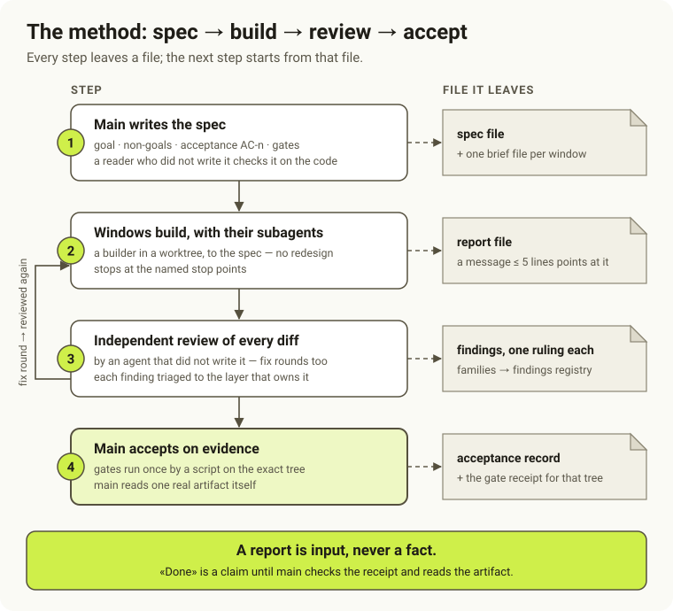
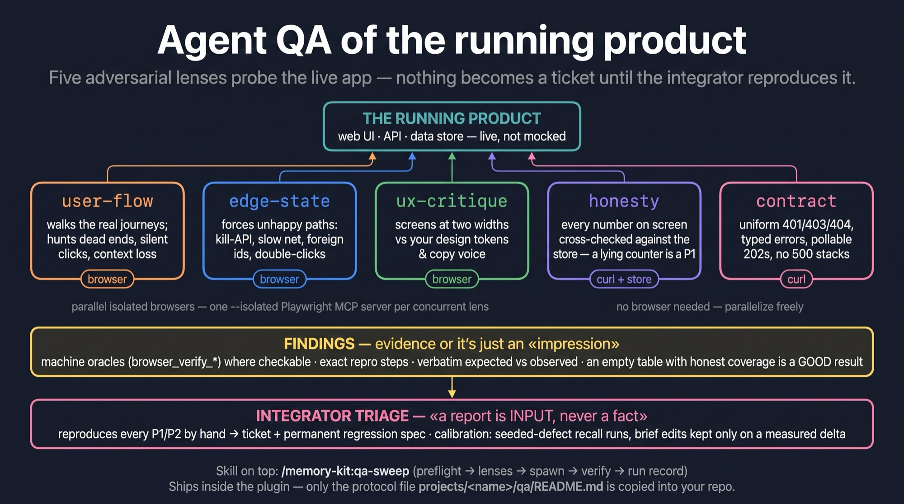

# Claude Memory Kit (`memory-kit` plugin)

For developers who run Claude Code on a real repository and delegate to helper agents or run several sessions:
memory as plain dated files in the repository (injected every session, size-capped, promoted only on your yes),
guards on git, secrets and tests, and a method for agent-orchestrated development as on-demand `reference/` files and
copy-on-request templates. An independent project, not made or endorsed by Anthropic.

```shell
/plugin marketplace add awrshift/agent-memory-kit
/plugin install memory-kit@memory-kit
/memory-kit:setup
```

Upgrading later — both steps, and the full `plugin@marketplace` id on the second one (the bare
name returns `Plugin "memory-kit" not found`):

```shell
claude plugin marketplace update memory-kit
claude plugin update memory-kit@memory-kit
```

## What it does at runtime

- **SessionStart — `session-start.py`** — injects the working agreement (`context/identity.md`), the discipline nudges
  that fire, session stats and per-project spec flags (`assumed` · `building > 14 d`), **the hot cache itself**, the
  newest handoff (its opening-note section first) and the knowledge index. A spec counts as `building` too long after
  `CMK_SPEC_STALE_DAYS` days. Profile depends on `source`:
  `compact` gets back exactly what compaction dropped, plus a loud "save memory now" when the compaction ran over unsaved
  memory; `resume` gets only the nudges and stats. It flags a project that wires its own copy of a kit hook (it would
  run twice), and one «Rails:» line while a root env file has no `Read` deny or an allow hands over a whole tool. Runs as
  `--part 1..6`, each under Claude Code's 10,000-character cap on one hook's context.
- **PreCompact — `pre-compact.sh`** — a manual `/compact` waits until `MEMORY.md` is fresh and inside its three caps
  (180 lines / 32 KB / 3000 chars per line). An automatic compaction is never blocked: Claude Code would fail the
  request (on a context-limit recovery) or skip the compaction.
- **PreToolUse(Edit|Write) — `protect-tests.py`** — asks before an edit that can weaken an existing test (an assertion
  line changed or removed, a `.skip`/`.only` added) and before any hand edit of a `.snap`; never blocks the red→green
  loop; a test file the base branch does not have (written on this branch, by any session) passes —
  base = `CMK_TEST_BASE_REF`, else `upstream`, else `origin`; `CMK_ALLOW_TEST_EDITS=1` opts out for a session.
- **PreToolUse(Bash) — `guard-git.py`** — blocks force push, `push --mirror`, `reset --hard`, `clean -f`, `branch -D`,
  `checkout .`, `restore .` wherever the flag sits in a real git command (never in quoted text or a commit message);
  `--force-with-lease` passes; `CMK_GIT_GUARD=off` opts out.
- **PreToolUse(Read|Edit|Write|Bash) — `guard-secrets.py`** — blocks reading or writing `.env`, `.env.local`,
  `.env.*.local`, `.env.production` (and development/test/staging), `*.pem`, `id_rsa*`, `*.p12` — by the file tools or by
  a shell command, inline script or redirection; one literal `echo`/`printf` appending a line (`>> .env`) passes; `source` / `.`, `cp`/`ln`/`mv`, `ls`,
  `test`, `git`, `rm` pass, and `.env.example` is never secret; `CMK_SECRETS_GUARD=off` opts out.
- **PreToolUse(Bash) — `guard-zsh-split.py`** — in zsh only: blocks an unquoted variable that zsh will not split into
  words the way bash does (the command would silently get one argument instead of several), and an unbraced `$NAME:`
  that zsh reads as a history modifier; `# zsh-split-ok` in the command passes it, `CMK_ZSH_GUARD=off` opts out.
- **SessionEnd — `session-end.sh`** — appends one timestamp line to `.claude/state/session-end.log` (Claude Code gives
  plugin SessionEnd hooks a 1.5-second budget).

The git and secrets guards carry `"onFailure": "block"` (Claude Code 2.1.295+; 2.1.290 was probed to accept the field and
keep every hook running, but it lets a crashed guard's call through; each guard first checks that `python3` actually
runs, so the macOS stub never blocks a session): a guard that crashes or times out blocks
the call instead of letting it through, and its own internal errors become an explicit "ask".

In a repository that never ran `/memory-kit:setup`, the hooks inject one pointer line and write
nothing.

## What it reads, writes and sends

- **Network: none.** No server, no telemetry, no package downloads: no hook or script in this
  folder opens a connection. Every one is readable Python or shell, standard library only.
- **Reads** the memory files of the repository you work in (below), and the `.claude/settings.json`
  files the rails nudge and `system-audit` inspect. `system-audit` also reads this repository's
  Claude Code session transcripts in `~/.claude/projects/` to count which layers actually fired;
  the report stays in the conversation.
- **Writes** only in an adopted repository: the memory state below and `.claude/state/` (session
  counter, logs). `/memory-kit:setup` writes into `.claude/settings.json` only after you approve
  the diff it shows: `"autoMemoryEnabled": false` if you choose kit-owned memory, and the
  permission rails — `Read`/`Edit` deny rules for root `.env` files and, where you agree, a
  narrow allow naming one exact script; never a broad allow, and never removing your rules.
- **Blocks**, through the guards above; each guard names its opt-out variable.

## Skills

| Skill | For |
|---|---|
| `close-session` | the end-of-session ritual: capture → audit for 3+-date repetition → promote on a yes → handoff; a project's own close list is opened from its steps, never instead of them; the close begins while there is room to finish it, with no context count; a memory line is merged into its topic at write time, never stacked |
| `memory-audit` | cap-trip surgery on the hot cache, by an approved move plan |
| `system-audit` | the periodic sweep of the whole system through its lenses (`skills/system-audit/references/lenses.md`), every finding evidence-backed — including the transcript profiler that answers "did this layer ever fire" and `gates.py`, which proves every PreToolUse hook through its exact wiring |
| `setup` · `tour` | adopt the kit here (`setup rails`: only the permission rails, on an adopted repo; `setup adopt` sorts the kit's practices for this repository) · walk through it on your own files |
| `session-review` · `second-opinion` | adversarial review of a session (a retro's facts come from the session logs by script, at most three changes) · of one high-stakes decision |
| `qa-sweep` | multi-lens agent QA of a running product (needs `projects/<name>/qa/README.md`, template in `reference/`), every finding and run record bound to the spec's `AC-n` |
| `document` | the human record of a change — PR body · changelog entry · release note · postmortem — drafted only from `git diff` / `git log`, never from what the model remembers building; the draft passes `scripts/claim-refs-check.py` (every path and commit it names exists) |
| `code-sync` | after a merge: specs reconciled against the code — `building → done` on a gate you ran, `stale` with the reason, `assumed` specs listed as owed ratification, the project map and `Last verified` refreshed. Surgical edits only |

Agents, listed in every session: `executor` (builds to a spec file in a worktree) · `recon` (read-only facts) ·
`idea-validator` (isolated critic) · `qa` (one adversarial lens on the running app).

Role templates, copied into `.claude/agents/` only on a yes (`setup` offers them; in trial in one project):
`templates/agents/` — `code-reviewer` · `prebuild-reader` · `tool-builder` · `web-recon` · `labeler`; the roster and
how each call picks a role and a model: `reference/helper-roster.md`. The method's depth — spec, review, acceptance,
the findings registry, parallel windows, measurement — lives in `reference/`; the root README's table says when to open
each file, and the proof tag inside each line says what it rests on.




## State it owns in your repository

Shared memory: `.claude/memory/MEMORY.md` · `context/handoffs/` · `knowledge/` · `.claude/rules/`.
Per project: `projects/<name>/` — `README.md` (the map of where that project's documents live,
plus the workflow tier), `BACKLOG.md`, `plans/` (specs executors build to, including a
`plans/*-assumed.md` when an executor was told to build past a missing decision), `research/`,
`decisions-log.md`, `review-findings.md`, `qa/`, `materials/`. Everything past the first two
appears on first use. `document` writes outside that tree, where a human looks for it:
`CHANGELOG.md` at the repo root, `docs/releases/`, `docs/postmortems/` — or wherever the
project README's map already sends that class.

## Environment knobs

`CMK_INJECT_BUDGET` (48000) · `CMK_MEMORY_LINE_CAP` (180) · `CMK_MEMORY_BYTE_CAP` (32768) ·
`CMK_MEMORY_MAXLINE_CAP` (3000) · `CMK_SPEC_STALE_DAYS` (14) · `CMK_ALLOW_TEST_EDITS=1` · `CMK_TEST_BASE_REF` · `CMK_GIT_GUARD=off` ·
`CMK_SECRETS_GUARD=off` · `CMK_ZSH_GUARD=off`.

Architecture and rationale: the kit repository's
[`docs/ARCHITECTURE.md`](https://github.com/awrshift/agent-memory-kit/blob/main/docs/ARCHITECTURE.md).
